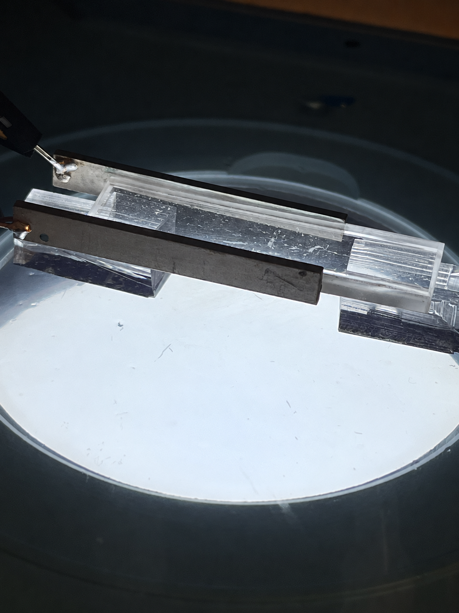
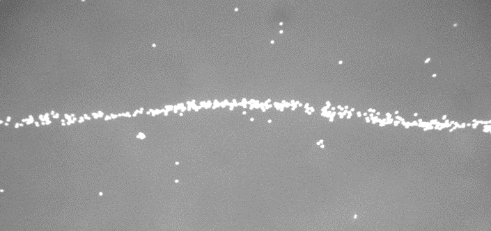
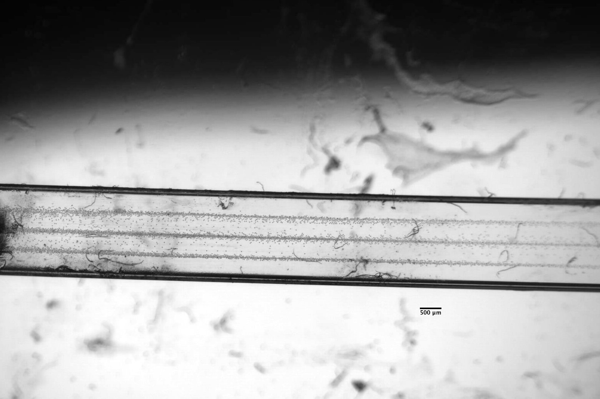

## Why focus particles?

The York-ODI project investigated acoustofluidic handling of microplastics in water. A useful first step is to control where suspended particles travel. Particles spread across a flow channel pass through different positions, making it harder to present them consistently to a downstream observation or collection region.

The aim was to use sound to gather particles into defined bands while liquid passed through a channel. This would provide a positioning step for a microplastic-handling or monitoring system. The experiments shown here demonstrate that particle-positioning step.

## How the setup worked

A piezoelectric ceramic, or PZT, converts an alternating electrical signal into mechanical vibration. When coupled to the flow-cell walls, the ceramic transfers that vibration into the liquid. The cell geometry and the contact between the ceramic and the walls affect how effectively the liquid is driven.

At suitable operating conditions, reflections in the channel produce a standing acoustic wave. The resulting acoustic radiation force moves particles across the channel toward preferred positions. For particles with a positive acoustic contrast factor, those positions are pressure nodes. A single-node pattern gathers particles into one band; a multinode pattern produces parallel bands. This is the [acoustic-focusing mechanism described by Piyasena and coauthors](https://pmc.ncbi.nlm.nih.gov/articles/PMC3325784/).

The close-up below shows the earlier flow-cell assembly, its PZT ceramics and supporting substrates. These are the parts that transmit and support the vibration. My later experiments used an existing 2 mm by 2 mm glass-capillary platform, with particle motion observed under a microscope.

*Earlier York-ODI flow-cell assembly. AI-retouched to remove the tubes and glass connectors for clarity. The [original photograph](/downloads/acute-acoustic-focusing/flow-cell-closeup-original.png) preserves the actual plumbing connections.*

The early flow-cell tests showed why mechanical coupling mattered. The slides describe improving vibration transmission with better PZT contact and using PDMS supports to reduce unwanted vibration. These observations informed the experimental work alongside the frequency estimates.

## Single-node focusing

In single-node focusing, particles gather into one band. The approximate drive frequency I recall for the single-node tests is **370 kHz**. This is a recalled estimate, rather than a precisely logged setting attached to this image.

*Single-band focusing view from the September 16 project presentation. Approximate single-node operating frequency, recalled from the tests, 370 kHz. The microscopy image is unaltered.*

## Three-node focusing

My later glass-capillary experiments produced the three parallel particle bands shown below. I varied the electrical drive and observed the response under the microscope, then prepared an ImageJ composite to make the pattern visible. The recorded test used 22 µm particles, 200 Vpp and a listed flow rate of 1 mL/min.

*Three-band particle-focusing result from my glass-capillary experiment slides. This is an ImageJ composite, rather than a single instantaneous frame. The original 500 µm scale bar is retained; no AI retouching was applied.*

## Choosing frequencies to investigate

I used a transverse standing-wave estimate to choose candidate frequencies. Fitting an integer number of half-wavelengths across the assumed channel width gives

<math xmlns="http://www.w3.org/1998/Math/MathML" display="block" aria-label="f sub n equals c divided by lambda sub n equals n c divided by two w">
  <mrow>
    <msub><mi>f</mi><mi>n</mi></msub>
    <mo>=</mo>
    <mfrac><mi>c</mi><msub><mi>λ</mi><mi>n</mi></msub></mfrac>
    <mo>=</mo>
    <mfrac><mrow><mi>n</mi><mi>c</mi></mrow><mrow><mn>2</mn><mi>w</mi></mrow></mfrac>
  </mrow>
</math>

Here, *c* is the sound speed in the liquid, *w* is the channel width, and *n* counts half-wavelengths across that width. In the idealized rigid-wall width mode, *n* also gives the number of pressure nodes. Using *c* = 1480 m/s and *w* = 0.002 m gives

| Idealized width mode, n | Estimated frequency |
|---|---|
| 1 | 370 kHz |
| 2 | 740 kHz |
| 3 | 1.11 MHz |
| 4 | 1.48 MHz |

These are model estimates for the 2 mm width, separate from the observed focusing images. The simplified relation gives a starting point for testing; it does not model the complete elastic walls, actuator, coupling and liquid assembly. The calculation follows the [ideal rectangular-channel resonance model described by Bruus](https://doi.org/10.1039/C1LC20770A).

## My contribution and outcome

I worked with an existing capillary and transducer platform, varied the drive settings, observed particle motion under a microscope, and documented the results for the research team. I also prepared the three-band ImageJ composite and compared observations with the standing-wave estimate.

The work linked the need for controlled particle positioning to practical decisions about geometry, vibration coupling, electrical drive and microscopy. The resulting images document focused particle bands as a step toward the project's microplastic-handling objective.

## More experiment images

The earlier September 16 presentation also contains these microscopy views. The dispersed-particle image is not labelled as a sound-off control, so it is linked as a separate observation.

- [Single-band microscopy image, original](/downloads/acute-acoustic-focusing/single-band-focusing-original.png)
- [Dispersed particle field, original](/downloads/acute-acoustic-focusing/dispersed-particles-original.png)
- [Wider flow-cell microscopy view, original](/downloads/acute-acoustic-focusing/wider-flow-cell-original.png)
- [Flow-cell and PZT close-up, original](/downloads/acute-acoustic-focusing/flow-cell-closeup-original.png)
- [Flow-cell and PZT close-up, AI edit with tubes and connectors removed](/downloads/acute-acoustic-focusing/Tubeless%20Microfluidic%20Channel%20on%20Illuminated%20Stage.png)

The single-band and three-band microscopy results have not been AI-edited.
