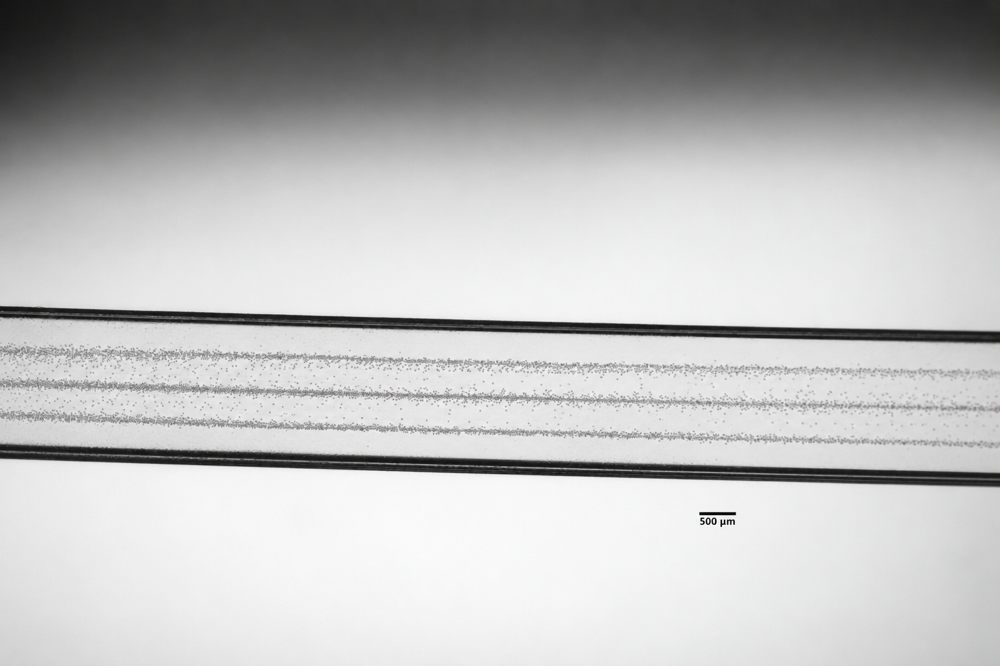

## Why focus particles?

The York-ODI project investigated acoustofluidic handling of microplastics in water. A useful first step is to control where suspended particles travel. Particles spread across a flow channel pass through different positions, making it harder to present them consistently to a downstream observation or collection region.

The aim was to use sound to gather particles into defined bands while liquid passed through a channel. This would provide a positioning step for a microplastic-handling or monitoring system. The experiments shown here demonstrate that particle-positioning step.

## My contribution

I worked with an existing capillary and transducer platform, varied the drive settings, observed particle motion under a microscope, and documented the results for the research team. I processed microscopy images in ImageJ and compared observations with a standing-wave estimate.

## Focusing results

### Single-node focusing

In single-node focusing, particles gather into one band across the channel.

*Single-band particle focusing in a flow channel.*

### Three-node focusing

The three-node pattern brings particles into three parallel bands across the glass capillary.

*Three-band particle focusing in a glass capillary. Scale bar, 500 µm.*

## How the setup worked

A piezoelectric ceramic, or PZT, converts an alternating electrical signal into mechanical vibration. When coupled to the flow-cell walls, the ceramic transfers that vibration into the liquid. The cell geometry and the contact between the ceramic and the walls affect how effectively the liquid is driven.

At suitable operating conditions, reflections in the channel produce a standing acoustic wave. The resulting acoustic radiation force moves particles across the channel toward preferred positions. For particles with a positive acoustic contrast factor, those positions are pressure nodes. A single-node pattern gathers particles into one band; a multinode pattern produces parallel bands. This is the [acoustic-focusing mechanism described by Piyasena and coauthors](https://pmc.ncbi.nlm.nih.gov/articles/PMC3325784/).

The flow-cell assembly below shows the PZT ceramics and supporting substrates that transmit and support the vibration. My experiments used an existing 2 mm by 2 mm glass-capillary platform, with particle motion observed under a microscope. The recorded capillary tests used 22 µm particles, 200 Vpp and a flow rate of 1 mL/min.

*Flow-cell assembly with piezoelectric ceramics and supporting substrates.*

The flow-cell tests showed why mechanical coupling mattered. Better PZT contact improved vibration transmission, while PDMS supports reduced unwanted vibration.

### Choosing frequencies to investigate

I used a transverse standing-wave estimate to choose candidate frequencies. Fitting an integer number of half-wavelengths across the assumed channel width gives

<math xmlns="http://www.w3.org/1998/Math/MathML" display="block" aria-label="f sub n equals c divided by lambda sub n equals n c divided by two w">
  <mrow>
    <msub><mi>f</mi><mi>n</mi></msub>
    <mo>=</mo>
    <mfrac><mi>c</mi><msub><mi>λ</mi><mi>n</mi></msub></mfrac>
    <mo>=</mo>
    <mfrac><mrow><mi>n</mi><mi>c</mi></mrow><mrow><mn>2</mn><mi>w</mi></mrow></mfrac>
  </mrow>
</math>

Here, *c* is the sound speed in the liquid, *w* is the channel width, and *n* counts half-wavelengths across that width. In the idealized rigid-wall width mode, *n* also gives the number of pressure nodes. Using *c* = 1480 m/s and *w* = 0.002 m gives

| Idealized width mode, n | Estimated frequency |
|---|---|
| 1 | 370 kHz |
| 2 | 740 kHz |
| 3 | 1.11 MHz |
| 4 | 1.48 MHz |

The relation estimates candidate frequencies for the 2 mm channel. Actual resonances also depend on the elastic walls, actuator and vibration coupling. The calculation follows the [ideal rectangular-channel resonance model described by Bruus](https://doi.org/10.1039/C1LC20770A).

## More experiment images

Additional microscopy views and flow-cell photographs.

- [Single-band microscopy image, original](/downloads/acute-acoustic-focusing/single-band-focusing-original.png)
- [Dispersed particle field, original](/downloads/acute-acoustic-focusing/dispersed-particles-original.png)
- [Wider flow-cell microscopy view, original](/downloads/acute-acoustic-focusing/wider-flow-cell-original.png)
- [Flow-cell and PZT close-up, original](/downloads/acute-acoustic-focusing/flow-cell-closeup-original.png)
