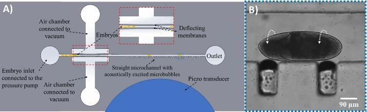
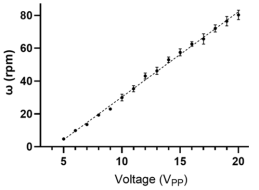
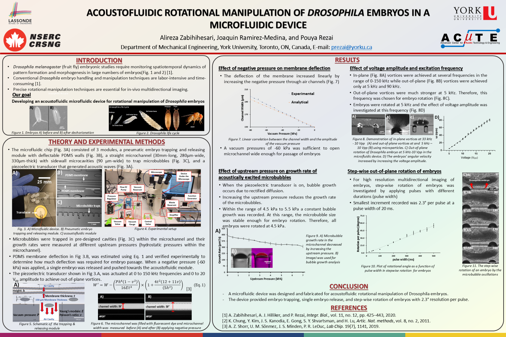
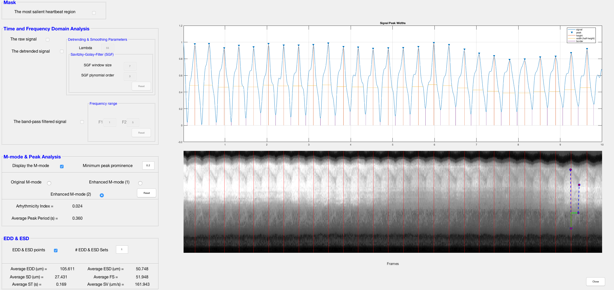
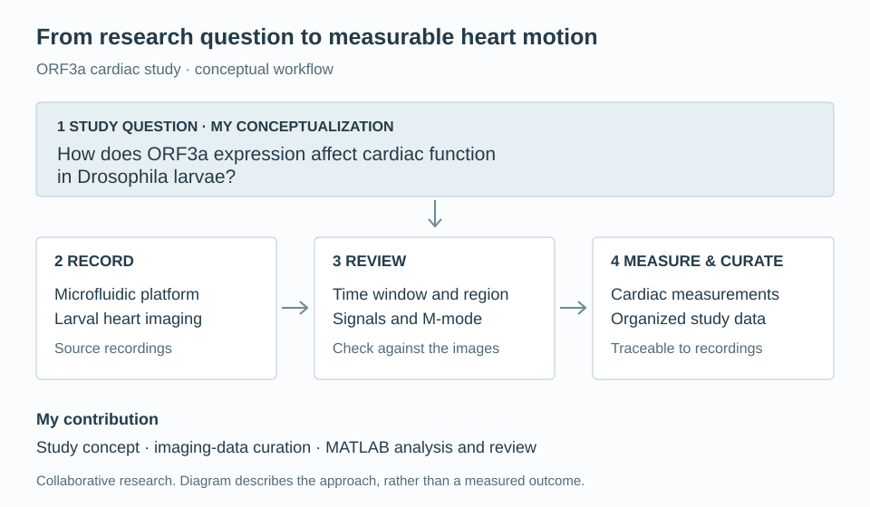

## The problem

Fruit flies (*Drosophila melanogaster*) are widely used to study development, genetics and disease, but their embryos and larvae are small and fragile, which makes them hard to position and hold still under a microscope. Microfluidic devices, i.e., chips with channels a fraction of a millimetre wide, can handle them one at a time.

First, developmental studies need to image many embryos, each from several sides. An embryo is an ellipsoid roughly 180 µm wide and 500 µm long ([Telley et al., 2012](https://pmc.ncbi.nlm.nih.gov/articles/PMC3384421/)), and turning it by hand, e.g., with tweezers, is slow and can damage it.

Second, the larval heart is used as a model for heart disease, including the effects of viral proteins such as the SARS-CoV-2 ORF3a protein. Measuring its beat requires holding a living larva still without dissection or anaesthetics, which can interfere with the heartbeat, and then quantifying the heartbeat from video.

## My contribution

I worked on both projects as an undergraduate research associate in Prof. Pouya Rezai's ACuTE microfluidics lab. Both were team studies, with Alireza Zabihihesari as first author.

On the embryo-rotation device, I took part in the experiments, sweeping the drive frequency and voltage to find where the embryo rotates out of plane and measuring how upstream pressure affects the growth of the trapped bubbles. I also calculated how far the valve membranes deflect under vacuum, to check whether the opening is wide enough for an embryo to pass. I am a co-author of the conference paper at IEEE EMBS Micro and Nanotechnology in Medicine (MNM) and of the poster shown below.

For the ORF3a study, I proposed the study question, whether expressing ORF3a in the larval heart causes cardiac dysfunction. I curated the microscopy recordings of larvae held in the lab's microfluidic chip and analyzed them with the lab's existing MATLAB software, extracting heartbeat signals and M-mode images to measure heart rate, rhythm and fractional shortening. I presented the project at the Lassonde Undergraduate Summer Research Conference and am a co-author on the manuscript submitted to *PLOS ONE*.

## Results

### Embryo rotation

*Embryo-rotation device (A) and microscopy view (B). A vacuum-operated valve releases one embryo at a time into a straight channel lined with trapped microbubbles, which are driven by a piezoelectric transducer. In (B), an embryo sits between two bubbles, and the dotted arrows show the direction of rotation.*

When the transducer is on, the bubbles oscillate and the embryo turns about its long axis. Across the 0 to 150 kHz sweep, out-of-plane vortices, which roll the embryo over so that a different side faces the microscope, formed only at 5 kHz and 90 kHz. They were much stronger at 5 kHz, so the rotation tests used that frequency.

*Embryo rotation speed against drive voltage at 5 kHz. The speed increases linearly with voltage between 5 and 20 Vpp (peak-to-peak volts).*

Pulsing the transducer turns the embryo in steps. The angle turned per pulse increased with pulse length, and the smallest step recorded was 2.3° per pulse with 20 ms pulses. Figure 11 on the poster shows one embryo turned through a full 360° in 90° steps.

*Embryo-rotation poster, covering the device and setup, membrane deflection under vacuum, bubble growth rate against upstream pressure, the effect of frequency and voltage, and stepwise rotation. [View the full-resolution poster (PDF)](/files/acoustofluidic-embryo-rotation-poster.pdf) or [download the original PowerPoint](/files/acoustofluidic-embryo-rotation-poster.pptx).*

### Larval heart recordings

The larval chip holds a living larva in place with suction through side channels, so the heart can be recorded through the microscope without dissection or anaesthetic.

<video controls autoplay muted loop playsinline preload="metadata" poster="/media/acute-acoustofluidics/cardiac-imaging-poster.png" aria-label="Archived Drosophila larval cardiac-imaging excerpt">
  <source src="/media/acute-acoustofluidics/cardiac-imaging.mp4" type="video/mp4" />
  <a href="/media/acute-acoustofluidics/cardiac-imaging.mp4">Download the cardiac-imaging clip</a>.
</video>

*Microscopy clip of a larva held in the chip, showing the heart wall contracting.*

*The lab's MATLAB analysis software. The top plot shows the heartbeat signal with each detected peak marked. The M-mode image below shows the heart wall moving over the same recording, with lines at the detected beats. The left panel sets the filtering and lists the derived values, including the arrhythmicity index, end-diastolic and end-systolic diameters (EDD, ESD) and fractional shortening (FS).*

## How it works

### Bubble streaming

The embryo-rotation chip is a PDMS (soft silicone rubber) channel bonded to glass, with a piezoelectric transducer on the glass. Microbubbles are trapped in 90 µm-wide side cavities along a 280 µm-wide main channel.

When the transducer is driven, the surface of each trapped bubble oscillates. This oscillation sets up steady vortices in the surrounding liquid, known as acoustic streaming. The bubbles also attract a passing embryo, which settles between two of them, and the streaming flow around it turns the embryo about its long axis.

### Upstream pressure and bubble growth

While the transducer is on, the trapped bubbles grow by rectified diffusion, i.e., slightly more dissolved gas enters each bubble while it is expanded than leaves while it is compressed. As a bubble grows, its resonance frequency changes. We measured the bubble growth rate at different upstream pressures (the hydrostatic pressure in the channel). Increasing the pressure reduced the growth rate, and between 4.5 and 5.5 kPa the growth rate stayed constant, so the bubble size was stable enough for rotation. All embryos were therefore rotated at 4.5 kPa.

### Valve deflection

The valve that holds and releases embryos is a 150 µm-wide section of channel between two flexible PDMS membranes, with an air chamber on the outside of each. With the embryo's long axis along the channel, the 150 µm opening holds it at rest. Applying vacuum to the air chambers pulls the membranes outward, and the flow pushes a single embryo through toward the bubbles.

I estimated the deflection of each membrane with the beam model of [Shorr et al., equations 5 and 6](https://doi.org/10.1039/C8LC01055B), which includes both bending and shear deformation.

<math display="block" aria-label="u max equals absolute pressure difference times h to the fourth times one minus nu squared, divided by 32 E t cubed, multiplied by one plus four t squared times twelve plus eleven nu divided by five h squared">
  <msub><mi>u</mi><mtext>max</mtext></msub><mo>=</mo>
  <mfrac><mrow><mo>|</mo><mi>ΔP</mi><mo>|</mo><msup><mi>h</mi><mn>4</mn></msup><mo>(</mo><mn>1</mn><mo>−</mo><msup><mi>ν</mi><mn>2</mn></msup><mo>)</mo></mrow><mrow><mn>32</mn><mi>E</mi><msup><mi>t</mi><mn>3</mn></msup></mrow></mfrac>
  <mrow><mo>[</mo><mn>1</mn><mo>+</mo><mfrac><mrow><mn>4</mn><msup><mi>t</mi><mn>2</mn></msup><mo>(</mo><mn>12</mn><mo>+</mo><mn>11</mn><mi>ν</mi><mo>)</mo></mrow><mrow><mn>5</mn><msup><mi>h</mi><mn>2</mn></msup></mrow></mfrac><mo>]</mo></mrow>
</math>

Here ΔP is the applied pressure difference, *h* is the wall height, *t* is the wall thickness, *E* is Young's modulus and ν is Poisson's ratio. With both membranes deflecting by the same amount, the channel opening is

<math display="block" aria-label="W open equals W zero plus twice u max"><msub><mi>W</mi><mtext>open</mtext></msub><mo>=</mo><msub><mi>W</mi><mn>0</mn></msub><mo>+</mo><mn>2</mn><msub><mi>u</mi><mtext>max</mtext></msub></math>

where *W*₀ is the resting width of 150 µm. In the conference paper, −60 kPa of vacuum widened the opening from 150 µm to ~180 µm, i.e., ~15 µm per wall. On the poster, the measured and calculated channel widths both increase linearly with vacuum.

The table evaluates the model at several trial wall thicknesses, taking the channel height as the wall height (*h* = 330 µm) with |ΔP| = 60 kPa. It uses ν = 0.495 for Sylgard 184 PDMS ([Müller et al., 2019](https://doi.org/10.1039/C8SM02105H)) and *E* = 2 MPa, with 1.32 to 2.97 MPa as the range of curing-dependent values measured by [Johnston et al. (2014)](https://doi.org/10.1088/0960-1317/24/3/035017). The opening is sensitive to both the wall thickness and the stiffness of the PDMS.

| Trial wall thickness | Displacement per wall at *E* = 2 MPa | Channel opening at *E* = 2 MPa | Opening across *E* = 1.32–2.97 MPa |
| --- | --- | --- | --- |
| 75 µm | 34.2 µm | 218.5 µm | 196.1–253.8 µm |
| 90 µm | 23.5 µm | 196.9 µm | 181.6–221.1 µm |
| 100 µm | 19.2 µm | 188.3 µm | 175.8–208.0 µm |
| 105 µm | 17.5 µm | 185.0 µm | 173.6–203.0 µm |
| 110 µm | 16.1 µm | 182.2 µm | 171.7–198.7 µm |
| 115 µm | 14.9 µm | 179.7 µm | 170.0–195.1 µm |
| 125 µm | 12.9 µm | 175.8 µm | 167.4–189.1 µm |
| 150 µm | 9.7 µm | 169.3 µm | 163.0–179.3 µm |

The highlighted 105 µm row is a trial thickness for illustration. The poster schematic labels the fabricated membrane as 150 µm thick.

<aside class="wall-thickness-callout" aria-label="Valve opening and embryo clearance at 105 micrometres wall thickness">
<strong>105 µm walls · 150 µm opening at rest → ~185 µm under −60 kPa vacuum</strong>

Each wall moves outward by ~17.5 µm. For a 180 µm-wide embryo centred in the opening, this leaves ~5 µm of total clearance, assuming E = 2 MPa and ν = 0.495.

</aside>

### Heartbeat signal and M-mode

*Workflow of the ORF3a study, from the study question to recording larvae in the microfluidic chip, reviewing signals and M-mode images, and measuring and curating the data.*

The analysis software first finds the most contractile region of the heart in the video and extracts a heartbeat signal from the change in image intensity there. After filtering, the peaks of this signal give the heart rate and the beat-to-beat variation in heart period, which is summarized as an arrhythmicity index.

The M-mode (motion mode) image takes the pixels along one line across the heart tube in every frame and places them side by side, so the moving heart wall traces a wave over time. From it, the end-diastolic diameter (heart fully relaxed) and end-systolic diameter (fully contracted) are measured. Fractional shortening is the percentage by which the diameter shrinks from relaxed to contracted. These values were compared between larvae expressing ORF3a in the heart and control larvae.

## Related project

I also worked on acoustic focusing of particles in a glass capillary, where standing sound waves gather suspended particles into bands, as a step toward microplastic handling. The flow cell, microscopy images, operating conditions and resonance calculation are on the [acoustic particle-focusing project page](/projects/acute-acoustic-focusing/).
