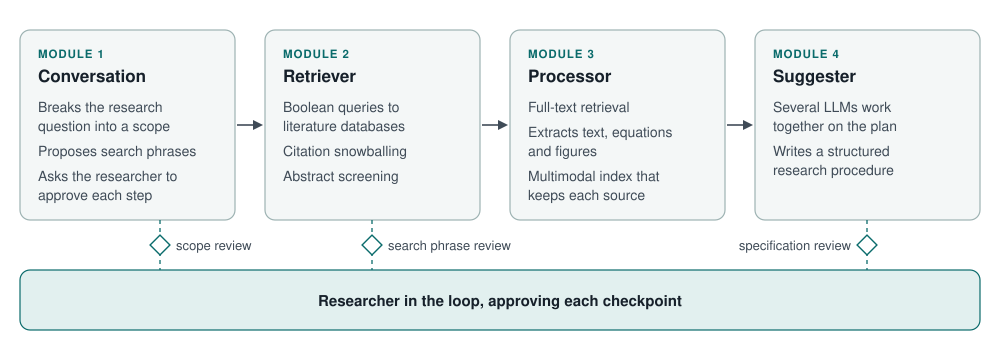

## The problem

Early-stage scientific research begins with an exhaustive literature review to establish foundational theories, identify state-of-the-art experimental methods, and formulate actionable research plans.

With global science and engineering publications exceeding three million articles per year, this process has become slow and methodical. Relevant studies are difficult to retrieve, screen, and synthesize into laboratory workflows. While commercial deep-search tools and general-purpose large language models can answer broad questions, their reliance on open web searches introduces unverified claims, hallucinated citations, and no mechanism to generate traceable, literature-grounded procedures tailored to a researcher's physical apparatus and experimental constraints.

## My contribution

As the sole software architect and developer, I created the Artificial Research Innovator Assistant (ARIA). ARIA is a researcher-in-the-loop, multi-agent system that mirrors early-stage research by breaking down research scope, retrieving and screening literature, extracting technical content from text and figures, and synthesizing tailored procedural guidance.

My work spanned the complete system lifecycle:

- Designed the four-module agent architecture (Conversation, Retriever, Processor, and Suggester) incorporating mandatory researcher approval gates at every transition.
- Built the end-to-end cloud infrastructure, including a React and Vite web interface, containerized Python FastAPI services on Google Cloud Run, CockroachDB for isolated persistent user workspaces, and Firebase authentication.
- Implemented multimodal retrieval-augmented generation pipelines that extract text passages, equations, and figure-caption pairs from PDFs while preserving strict citation provenance.
- Built a multi-LLM procedural synthesis engine where specialized agents (Detailer, Innovator, and Integrator) collaborate to turn indexed technical passages into step-by-step procedures.
- Conducted a full case study on dropwise condensation and designed an evaluation study with four independent domain experts across different engineering fields.

ARIA forms one of the two core pillars of my MASc thesis.

## Visual architecture and case-study results

*ARIA modular workflow. Specialized agent modules handle scoping, database retrieval, full-text processing, and procedural synthesis, with human-in-the-loop checkpoints between stages.*

In a surface-engineering case study on enhancing dropwise condensation, ARIA reduced 11,491 candidate article identifiers down to 22 foundational papers and synthesized an initial research procedure with 24 embedded source figures in under two hours. The same scoping and procedural planning conducted manually beforehand by the same researcher took weeks of effort.

Four independent domain experts spanning doctoral candidates to full professors evaluated ARIA across experimental and numerical procedures. Evaluators rated the system across 19 criteria grouped into five dimensions on a 1 to 10 scale.

| Evaluation dimension | Mean score | Standard deviation |
|---|---|---|
| Overall utility | 9.63 | 0.48 |
| Educational value | 9.08 | 1.13 |
| Time savings | 9.00 | 1.15 |
| Presentation quality | 8.58 | 1.66 |
| Output quality | 8.56 | 1.69 |

All four domain experts agreed unanimously (10.00 out of 10, SD 0.00) that ARIA provides an effective procedural starting point that broadens research understanding and gives material researchers can build upon directly.

## How it works and multi-agent system

### Conversation module

The Conversation module breaks a raw scientific question into a structured research scope. It generates natural-language search phrases, identifies key investigation parameters, and proposes research specifications. The researcher reviews and edits these phrases directly in the interface before any external search is executed.

### Retriever module

The Retriever module converts approved phrases into optimized Boolean queries for scholarly databases (such as OpenAlex and arXiv). To ensure comprehensive coverage, it runs citation snowballing to uncover related work cited by or citing candidate articles.

To handle large candidate pools without excessive API costs, the system applies computationally inexpensive rule-based metadata pruning, narrowing thousands of candidates to hundreds. A multi-prompt LLM abstract screening pipeline then adjudicates relevance against the agreed scope, passing only verified key papers to the next stage.

### Processor module

The Processor module fetches full-text articles and extracts procedure text, mathematical equations, and figure-caption pairs. Extracted elements are indexed in a multimodal retrieval-augmented generation vector store that maintains the exact source paper and section for every passage, preventing fabricated citations.

### Suggester module

The Suggester module translates the indexed evidence into an actionable procedure tailored to user-selected specifications. Multiple specialized language model agents collaborate through defined roles:

1. A Detailer agent gathers and drafts foundational procedural steps directly grounded in retrieved passages.
2. An Innovator agent suggests novel modifications or creative variations justified by the literature.
3. An Integrator agent harmonizes the steps, embeds relevant source figures to illustrate apparatus setups, and formats the output into a comprehensive procedure plan.

### Cloud deployment and human oversight

ARIA runs as a secure multi-user web application. Researchers work within private persistent sessions, approving search phrases, screening thresholds, and procedural specifications at dedicated checkpoint gates. This ensures that artificial intelligence accelerates literature processing while the researcher maintains complete scientific direction.