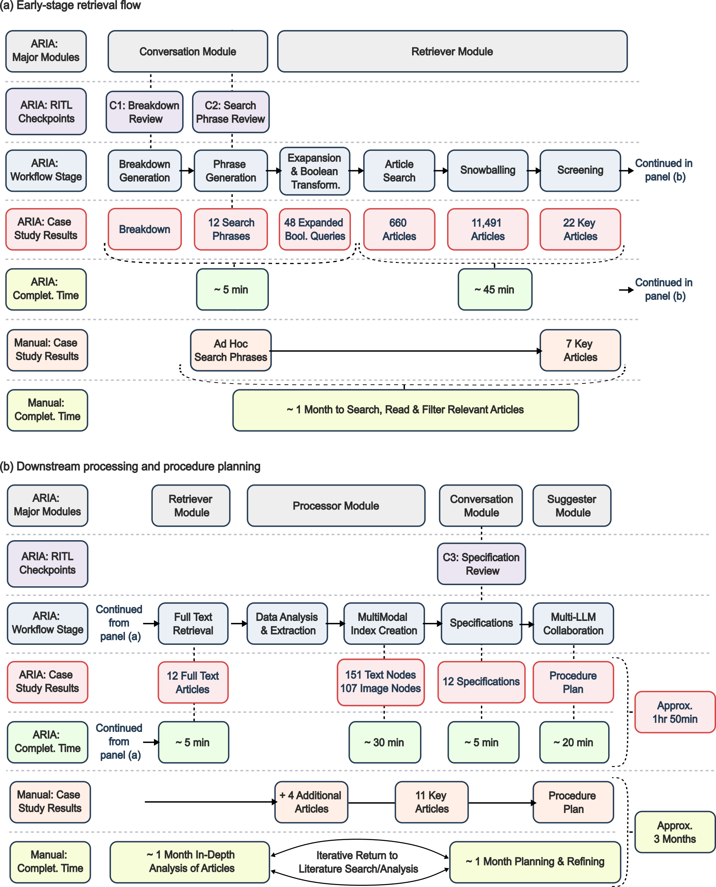
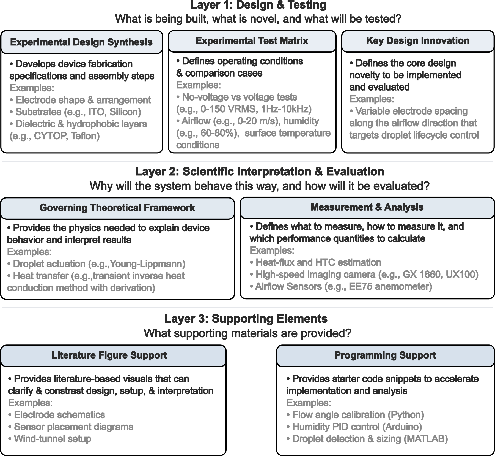
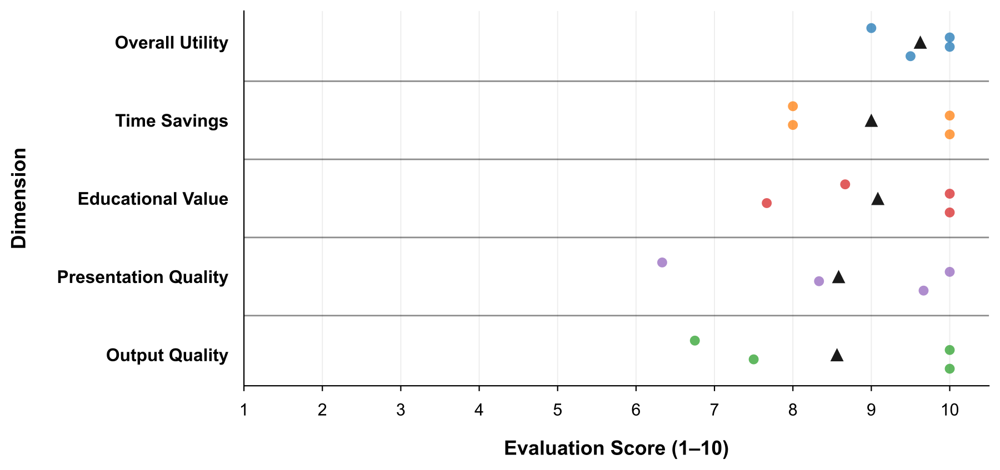
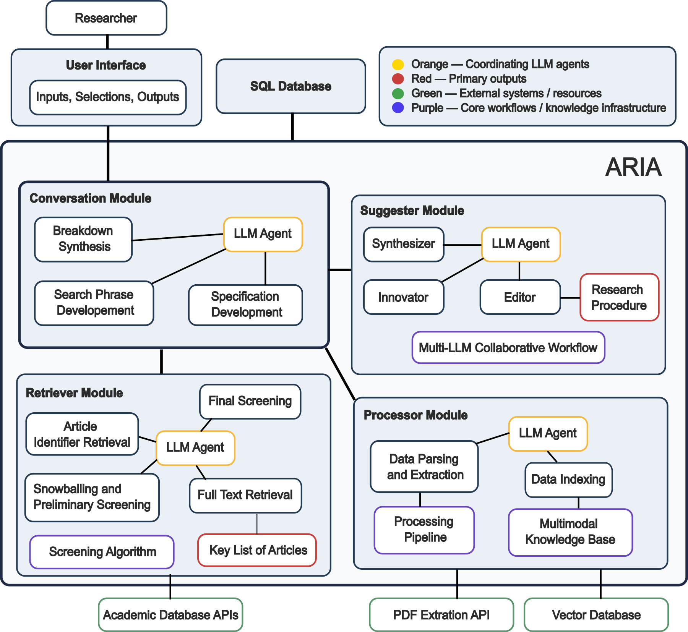

## The problem

A new research project usually starts with a literature review, followed by planning how the work will be done. Both steps are slow, and they become harder as the literature grows; more than three million science and engineering articles are now published each year. For a researcher new to a topic, finding the relevant studies, screening them and turning them into a procedure can take months.

Large language models (LLMs) can help, but in niche scientific fields they can misread specialized terms and produce fabricated content (so-called "hallucinations"). Commercial "deep search" tools add web searches, but they draw on general web sources such as blogs and press releases, and studies of these tools report citation accuracy of only 40 to 80%. Neither produces a step-by-step procedure that is traceable to its sources and tailored to the researcher's goals and constraints.

## My contribution

I built the Artificial Research Innovator Assistant (ARIA), a multi-LLM agent system that carries out the literature review and procedure planning together with the researcher. I wrote all of ARIA's software; the concept and methodology were developed with my co-authors.

Specifically, I (1) built the four modules that search, screen and process the literature and write the plan, including the LLM prompts behind them, (2) deployed ARIA as a multi-user web application on Google Cloud, (3) ran a case study on my own MASc topic and compared it with a manual workflow on the same question, and (4) designed the evaluation in which four domain experts used ARIA on research questions from their own fields.

## Results

For the case study, the research question was how electrowetting could be used to enhance [dropwise condensation under shear airflow](/projects/electrowetting-condensation/), which is the subject of my MASc experiments.

*ARIA and the manual workflow on the same research question. (a) Search and screening. (b) Processing and procedure planning. Completion times are approximate.*

ARIA expanded 12 search phrases into 48 queries, which returned 660 articles. Following the references and citations of these articles grew the pool to 11,491 identifiers (duplicates included). Screening then reduced the pool to 22 key articles in about 50 minutes. These 22 included all 7 key articles found in the first month of the manual workflow, plus 15 more. The full workflow, up to a written procedure plan, took about 1 h 50 min, compared with about three months by hand. It should be noted that the manual workflow ended with notes, slides and code rather than a single written plan. Moreover, only 12 of the 22 full texts were available to ARIA for building the plan.

*Structure of the procedure plan ARIA generated for the case study, organized into three layers. Grey text gives examples from the plan.*

The plan covered nine sections addressing the 12 topics I selected. Throughout the plan, ARIA embedded 24 figures from the source articles and added three starter code snippets in Python, Arduino and MATLAB.

*Ratings from four domain experts across five dimensions, on a 1 to 10 scale. Each coloured dot is one expert's mean score for that dimension; the black triangle is the mean of the four experts.*

The four experts worked in water treatment, fluid mechanics, nuclear thermohydraulics and separation science, and included a PhD student, a postdoctoral researcher and two professors. Each used ARIA on a research question from their own field, with experimental or numerical procedures, and rated it on 19 criteria grouped into five dimensions.

| Evaluation dimension | Mean score | Standard deviation |
|---|---|---|
| Overall utility | 9.63 | 0.48 |
| Educational value | 9.08 | 1.13 |
| Time savings | 9.00 | 1.15 |
| Presentation quality | 8.58 | 1.66 |
| Output quality | 8.56 | 1.69 |

All four experts gave the top score (10) to the statement that the procedure was a good starting point they could build on and explore further. Output quality scored lowest and varied most. Within it, the criteria on suggested novel ideas scored lowest (7.75 to 8.25). The lower presentation scores, and the comments behind them, concerned navigating the interface rather than the outputs. With four evaluators, these results are preliminary and do not establish how well ARIA generalizes to other fields.

## How it works

*ARIA's four modules. Each module has an LLM agent (orange) that coordinates its steps. The researcher works through the user interface, and all modules share an SQL database.*

ARIA follows the order in which a researcher usually starts a project, i.e., define the question, search the literature, read the key papers and plan the work. Each module has an LLM agent that coordinates its steps, while separate LLM calls handle narrow tasks such as screening one abstract.

### Conversation module

The Conversation module breaks the researcher's question into its key concepts and how they interact (the "breakdown"), then expresses these as natural-language search phrases. The researcher reviews the breakdown and selects, edits or adds search phrases before any search is run; these are the first two checkpoints. After the papers are processed, the module proposes specifications, i.e., the procedural topics the plan should cover (e.g., sample preparation or a mesh convergence study). Choosing them is the third checkpoint.

### Retriever module

The Retriever module converts the approved phrases into Boolean queries for academic database APIs, such as OpenAlex, Semantic Scholar and arXiv. It then follows both the references and the citing articles of each result (so-called snowballing) to widen the search.

LLM screening becomes costly at this scale, so the module first narrows thousands of candidates to a few hundred with inexpensive steps. It compares each available abstract with the research focus using text embeddings, and ranks the remaining articles by how often and by which route they were retrieved. In the case study, these steps removed ~98% of the pool before any LLM screening. Two LLMs then judge each remaining abstract against different criteria (the core objectives and the additional aspects of interest), and a third, more capable LLM makes the final decision from their decisions and reasons. Finally, the module retrieves the full texts of the selected articles.

### Processor module

The Processor module extracts procedure text, equations and figures with their captions from each full text. It uses rule-based pattern matching, followed by an LLM check of each match. The extracted content is stored in separate text and image indices for retrieval-augmented generation (RAG), where relevant passages are retrieved and passed to an LLM as context. Every entry keeps its source article. As such, the plan cites only articles that ARIA retrieved and screened, and each step can be traced to a paper the researcher can check.

### Suggester module

The Suggester module writes the plan one specification at a time. For each specification, it retrieves the most relevant text and figures; a Filter LLM flags poor matches, and an Optimizer LLM rewrites the query to retrieve better ones. Two Synthesizer LLMs then draft that section of the plan, the first from the text and the second adding source figures that show how a step is performed or measured. An Innovator LLM develops the researcher's proposed novelty, or suggests one where the literature supports it. Finally, an Editor LLM combines the sections into one plan and checks it for consistency and repetition.

### Web application

So that other researchers could use ARIA for the evaluation, I deployed it as a multi-user web application. Each researcher signs in and works in a private workspace, and their inputs, selections and outputs are saved between sessions.
