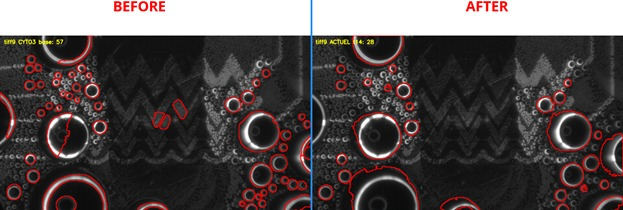
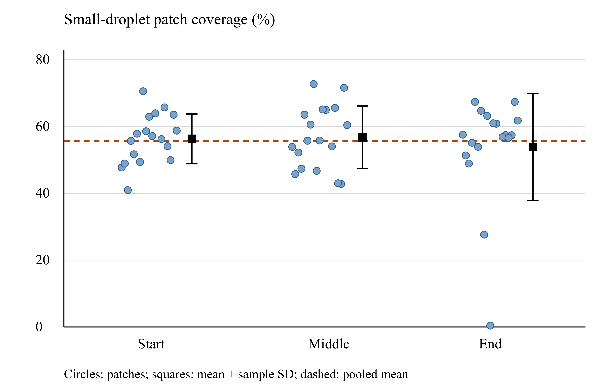

## The problem

During dropwise condensation, water collects on a cooled surface as many separate droplets rather than a continuous film. These droplets grow and merge (coalesce) until they are large enough to be removed, which clears the surface for new droplets to form. A single frame of high-speed video can hold more than a hundred droplets, so counting merges or following how one large droplet formed is not practical by hand.

Tracking software follows each object from one frame to the next. However, when two droplets merge, one of them disappears, and the tracker has to decide what happens to its identity. The merge detection built into LapTrack, the tracking library used here, did not identify the merges in these recordings. Detection is also difficult on this surface. The electrode pattern is visible under the droplets, reflections and lighting vary across the image, and many droplets are too small to separate individually.

## My contribution

This project builds on image-processing work by an ENSTA (France) engineering intern whom I supervised. The intern developed the first version of the analysis on 18 archived condensation recordings, including Cellpose detection fine-tuned for each video, an estimate of the droplets too small to detect, and a coalescence rule added to LapTrack tracking.

I built Droplet Coalescence Studio, a Python package that runs these steps as one reusable pipeline, from the command line for batch work or from a Streamlit app for choosing a dataset, previewing the region of interest and browsing results. The pipeline records each droplet's merges as a family tree, exports tables and annotated videos, and includes regression tests. I am now applying it to the transport recordings from my [electrowetting condensation experiments](/projects/electrowetting-condensation/), with a Cellpose model fine-tuned on corrected frames of those recordings, and using the measured droplet sizes for first-order heat-transfer estimates.

## Detection and small-droplet coverage

Both figures below come from the intern's analysis of the archived recordings.

Fine-tuning made the largest difference to detection. The generic Cellpose model outlines parts of the electrode pattern as droplets. After fine-tuning, these false outlines are gone, but many of the smallest droplets are still not outlined.

*The same frame outlined by the generic Cellpose model (left) and by a fine-tuned model (right).*

The droplets that cannot be detected individually still cover part of the surface, which matters for the heat-transfer estimate. To measure this coverage, square patches inside regions of small droplets were annotated by hand at the start, middle and end of each of the 18 recordings (54 patches). The mean coverage was 55.7 %, and this single ratio is applied to every small-droplet region. The patches from the end of the recordings vary the most.

*Coverage of the hand-annotated small-droplet patches, grouped by position in the recording. Circles show individual patches, squares show the mean with sample standard deviation, and the dashed line shows the pooled mean.*

## How it works

### Detection

Each frame is processed separately. Cellpose, a neural network originally developed to segment cells in microscopy images, outlines each droplet. The model is fine-tuned on frames whose droplet outlines were corrected by hand. Each outline is stored as a center and the radius of a circle with the same area.

Only droplets inside a fixed region of interest (ROI) are counted. A droplet at the edge of the ROI is kept if its center lies inside the region or within half a radius of its edge. Regions of droplets too small to detect are found separately, from the fine-scale texture they leave in the image between the detected droplets. Their coverage then comes from the hand-annotated ratio above, which has not yet been measured for the transport recordings.

### Tracking and coalescence

LapTrack links the detected droplets between consecutive frames, which gives each droplet an identity over time. A merge is flagged when (1) a droplet disappears between two frames, (2) in the next frame its outline overlaps that of a larger droplet, and (3) no new droplet appears at its position within the next two frames, which would indicate a detection flicker rather than a merge. The merged droplet keeps the identity of its largest parent. Each flagged event is a possible merger and is checked against the images.

### Droplet family trees

Each merge is recorded as a link between the droplets that merged and the droplet they formed. Following these links backward from a large droplet gives its family tree, i.e., every smaller droplet that merged to form it. The results are exported as an interactive tree, a spreadsheet of droplets, trajectories and coalescence events, growth curves and an annotated video.

### Heat-transfer estimates

Each droplet is approximated as a spherical cap, so its volume follows from the measured radius and the contact angle. The contact angle is an input chosen for each experiment. For the activated regions in the transport recordings it is ~ 89°. The estimate combines the latent heat released by condensation, from the change in water volume on the surface over time, and the sensible heat transferred from the flowing air to the dry part of the surface. These are first-order, model-based estimates; the application does not measure heat flow through the surface. Droplets that move into or out of the ROI also change the measured volume, so the time window used for the estimate has to account for them.
