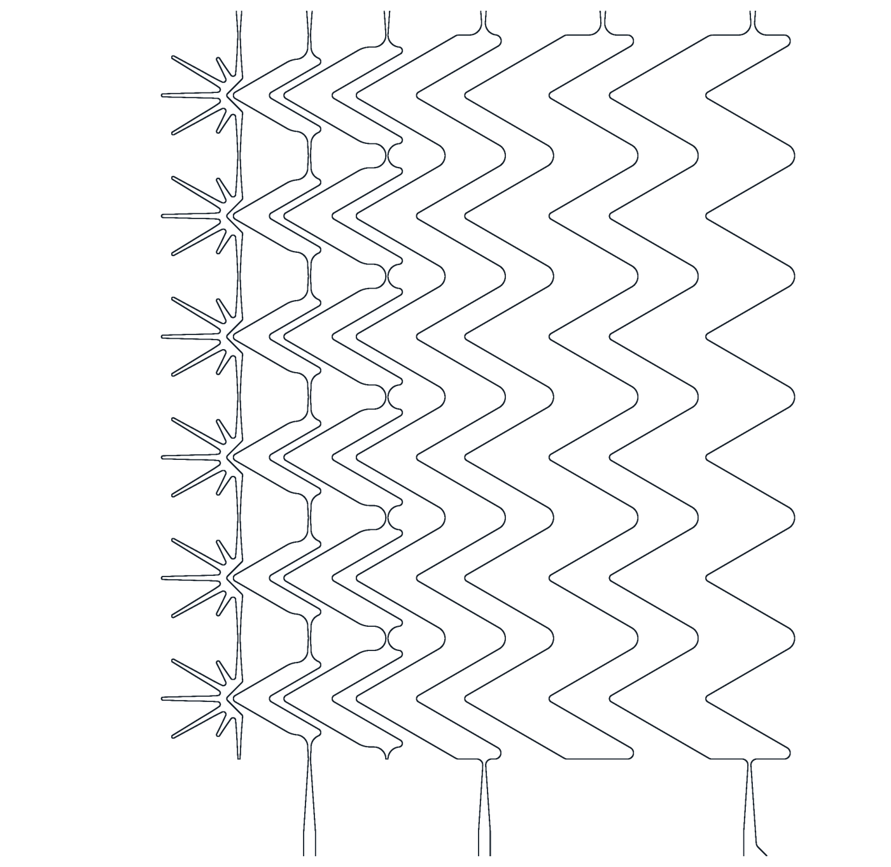
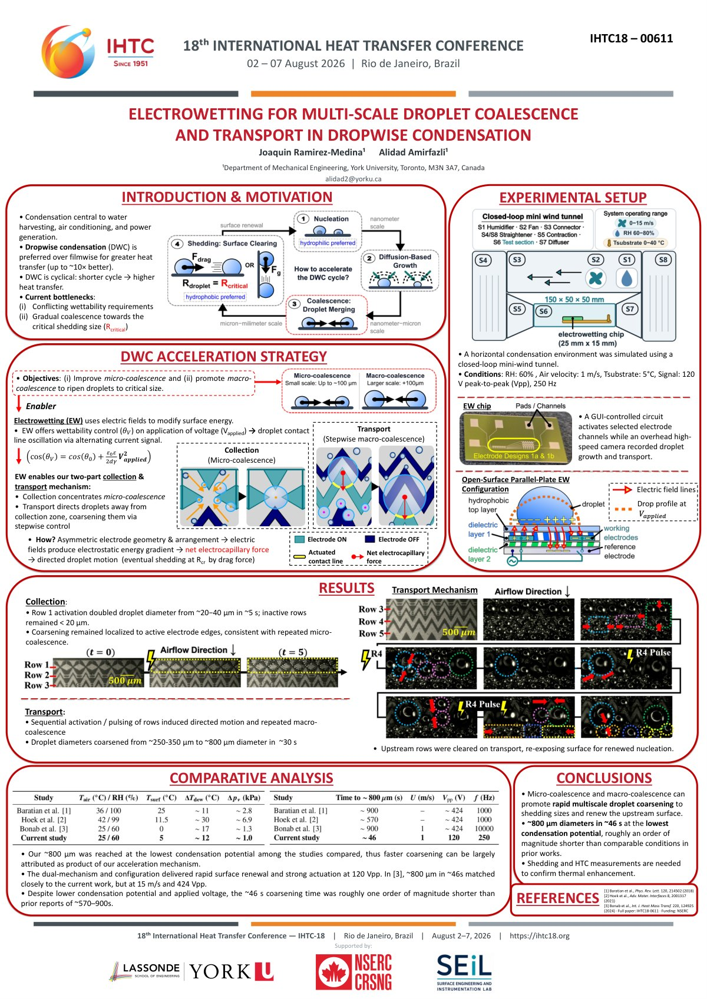

## Why condensate needs help leaving

When humid air meets a cold surface, water condenses either as a continuous film or as separate droplets. Dropwise condensation can transfer heat up to an order of magnitude faster than a film, but only while droplets keep growing, merging and leaving so that fresh surface is exposed. A droplet has to reach a critical size before airflow or gravity can pull it off, and on a horizontal surface that wait sets the length of the whole cycle.

Coatings and surface textures fix the wettability when the part is made, so they can only offer one compromise across the stages of the cycle. Electrowetting changes wettability with an applied voltage, so the same surface can treat each stage differently while keeping a low-adhesion hydrophobic baseline for shedding.

## Collection, then transport

The chip carries two kinds of electrodes under a hydrophobic dielectric stack.

- **Collection.** Star-shaped electrodes create preferred sites for nucleation and small-scale merging. At active electrode edges, droplets grew from about 20 µm to about 40 µm within about 5 s, while droplets over inactive regions stayed below 20 µm.
- **Transport.** Rows of chevron electrodes switch on in sequence. Each active row pulls nearby droplets toward it, so droplets sweep away from the collection zone and merge into larger ones on the way. The surface they leave behind is free for new nucleation.

*Electrode geometry. Star-shaped collection electrodes (left) feed chevron transport columns that widen from left to right.*

Together, the two stages brought droplets to shedding scale (about 800 µm diameter) in about 46 s. Three recent electrowetting condensation studies report roughly 570 to 900 s for the same stage, while also using higher voltage, frequency, airflow velocity or condensation potential.

The drive signal is a 120 Vpp sine wave at 250 Hz. AC was chosen over DC to limit charge build-up in the dielectric and extend device life.

## Experiments

Tests ran in a closed-loop mini wind tunnel with independent control of humidity, air velocity and substrate temperature, here 60 % relative humidity, 1 m/s and a 5 °C substrate. A thermoelectric module cooled the chip, and an overhead high-speed camera (Chronos 2.1-HD with a Navitar lens stack) imaged a field of view of about 3.2 mm × 1.6 mm.

A function generator and a high-voltage amplifier supplied the signal. Solid-state relays on a circuit board I designed routed it to each electrode row, and a GUI I wrote set the switching sequence. The [drive electronics page](/projects/electrowetting-drive-electronics/) has the details.

## What the measurements show

These measurements show faster droplet coarsening and surface renewal. They are not a direct heat-transfer measurement. The result suggests a route toward better thermal performance under practical operating conditions.

*IHTC-18 poster, Rio de Janeiro, August 2026. Select the image to open the PDF.*
