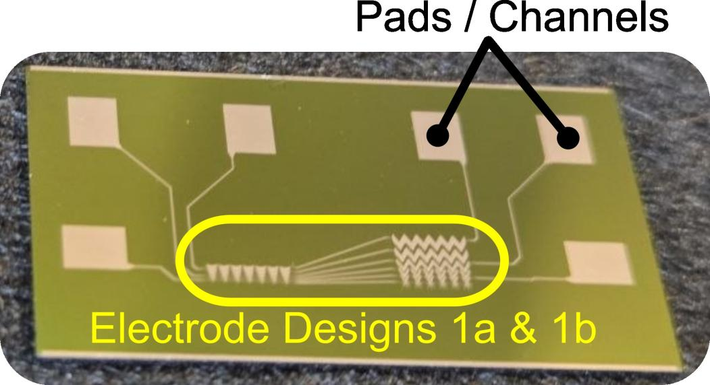
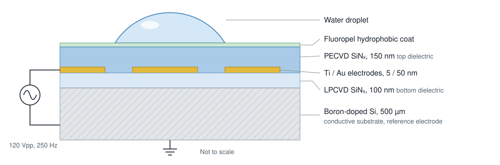
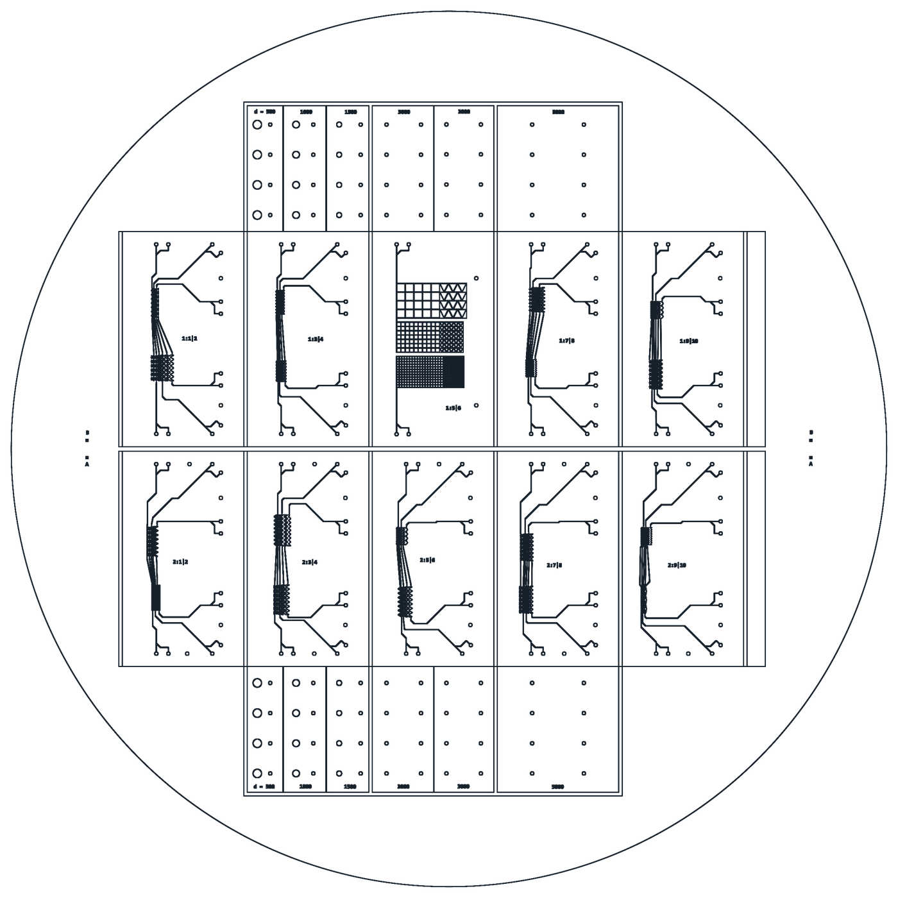
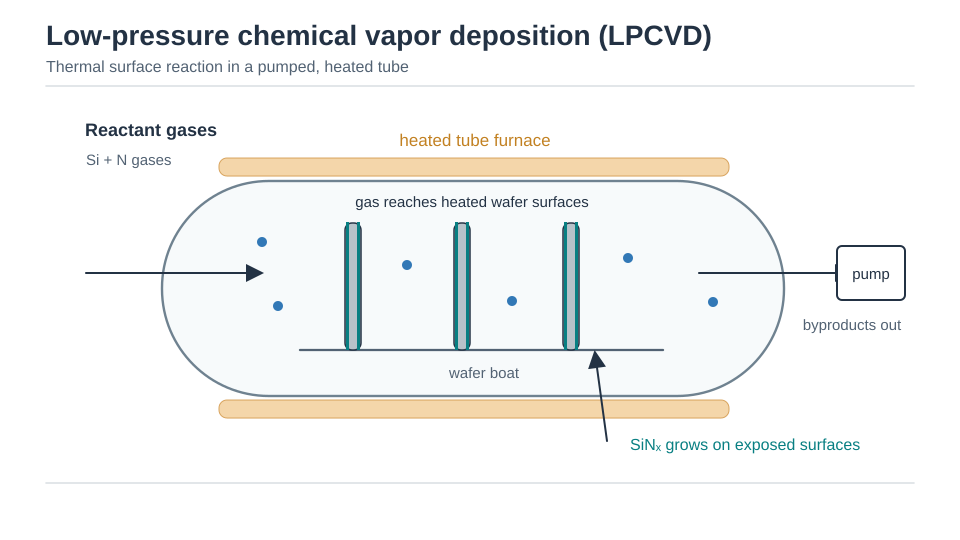
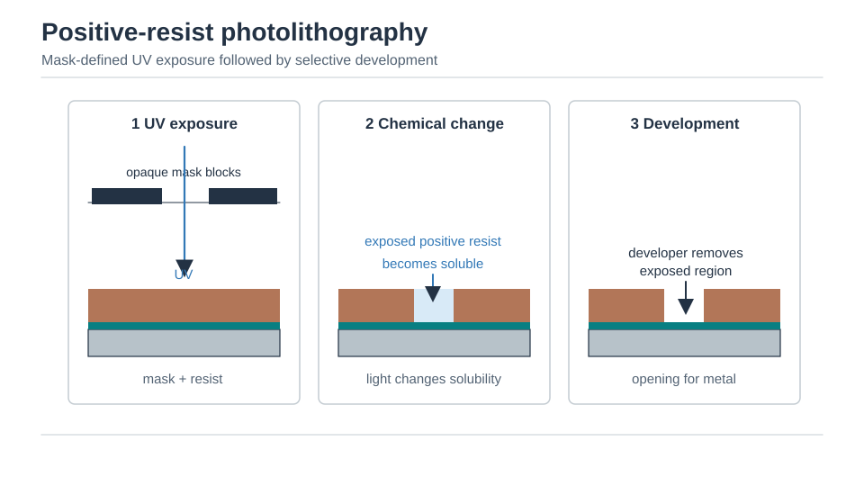
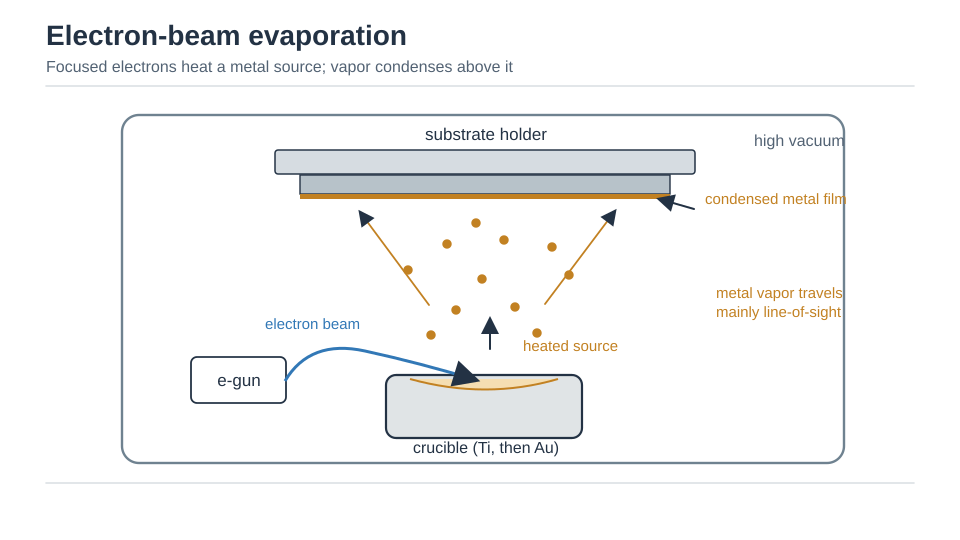
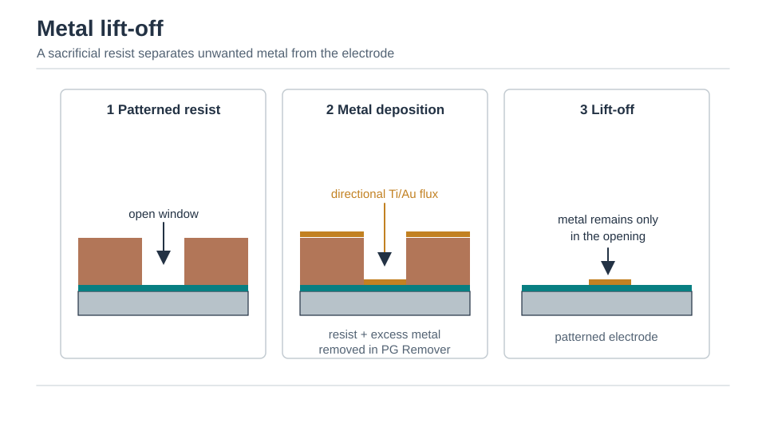
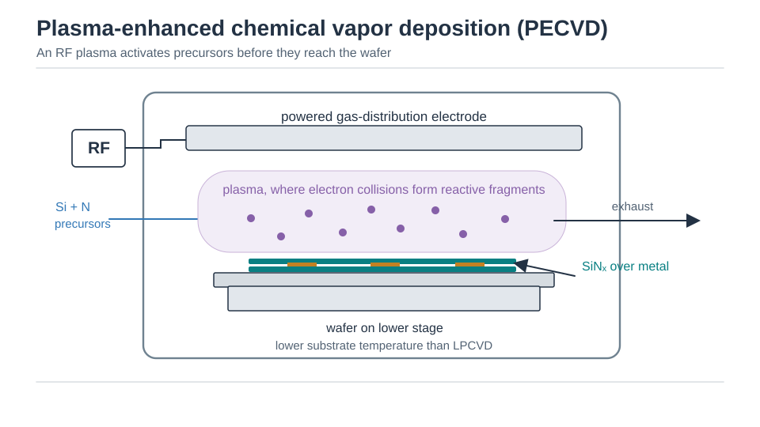
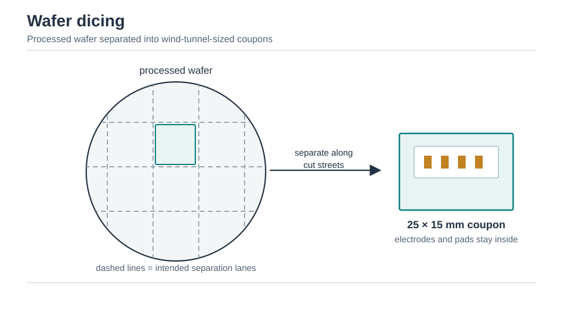
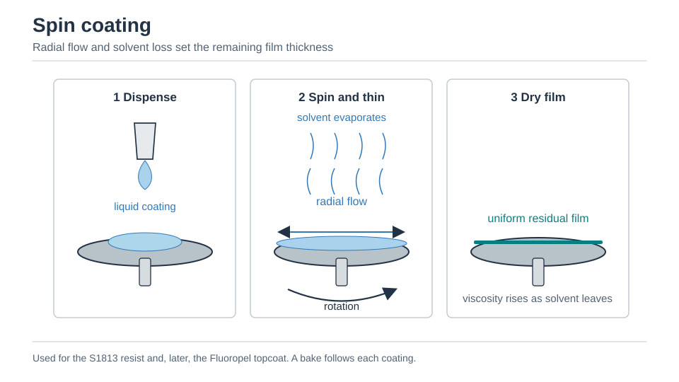

## The problem

To enable electrowetting without disrupting dropwise condensation, a microfabricated chip must sandwich patterned driving electrodes between thin dielectric layers while presenting a defect-free, pinhole-free hydrophobic top surface.

This architecture introduces several competing physical requirements.

First, the condensing surface must be uniformly hydrophobic and continuous everywhere. If droplets come into direct contact with bare metal or step edges, they pin to the surface and refuse to depart.

Second, strong electrowetting forces require thin dielectric films so high electric fields can be sustained at moderate voltages (120 Vpp). However, thin dielectric coatings (100 nm LPCVD and 150 nm PECVD silicon nitride) are vulnerable to pinholes, particle contamination, and dielectric breakdown.

Third, the entire multi-layer sequence had to be adapted to in-house cleanroom capabilities at the York University Microfabrication Facility (YMF), resolving plasma charging risks and wafer dicing constraints.

## My contribution

I designed the complete photomask layout and developed the seven-step microfabrication workflow.

I executed the photolithography, electron-beam evaporation, lift-off, and plasma-enhanced chemical vapor deposition runs at YMF. To overcome dielectric breakdown and yield loss, I designed a multi-checkpoint electrical screening protocol using probe-station current-voltage (I-V) measurements. I also developed an oxygen plasma ash recipe on a reactive ion etching (RIE) tool to strip degraded fluoropolymer layers cleanly without damaging the underlying nitride, enabling reliable chip recoating.

## Visual results and cleanroom hardware

*Completed 25 mm × 15 mm electrowetting chip, as shown in the IHTC-18 poster. The original annotations identify the contact pads and highlight the collection and transport electrode designs.*

*Cross-section schematic of the multi-layer electrowetting device stack. The conductive boron-doped silicon substrate serves as the reference ground, while patterned Ti/Au electrodes sit between LPCVD and PECVD silicon nitride dielectric layers beneath a hydrophobic fluoropolymer coat.*

*Photomask layout for a full wafer, containing ten electrode-array chip variants and diagnostic test structures of varying diameters.*

## How it works and process engineering

### The seven-step fabrication sequence

1. **Starting wafer.** Four-inch boron-doped silicon wafers (500 µm thick, 0.001 to 0.005 Ω·cm) provide a low-resistance ground plane. A 100 nm stoichiometric LPCVD silicon nitride bottom layer provides electrical insulation beneath the metal traces.
2. **Photolithography.** Shipley S1813 positive photoresist is spun to approximately 1.8 µm, pre-baked at 115 °C, and exposed on an OAI 800E mask aligner (150 W for 14 s). Wafers are developed in MF-319 for 45 s and rinsed in deionized water.
3. **Metallization.** Electron-beam evaporation (Angstrom Nexdep) deposits a 5 nm titanium adhesion layer followed immediately by 50 nm of gold without breaking vacuum.
4. **Lift-off.** Wafers soak in PG Remover at 80 °C for 45 min with ultrasonic agitation. This dissolves the photoresist and lifts off excess metal, leaving sharp gold electrodes on the LPCVD nitride.
5. **Top dielectric.** A 150 nm silicon nitride dielectric layer is deposited over the electrodes by plasma-enhanced chemical vapor deposition (PECVD, Trion Minilock Phantom Duo) at 300 °C.
6. **Dicing.** An automated dicing saw cuts wafers into 25 mm × 15 mm coupons sized precisely for the wind tunnel cooling block.
7. **Hydrophobic coating.** Cytonix Fluoropel PFC1601VF-S is spin-coated and baked at 180 °C for 30 min, producing an ultra-thin fluoropolymer finish with an advancing water contact angle exceeding 115°.

*The fabrication sequence in order, showing cross-sectional evolution from bare substrate to cured hydrophobic coat. Schematics are conceptual and not to scale.*

### Electrical isolation and screening checkpoints

Thin dielectric breakdown was investigated through structured electrical screening checkpoints.

- **Checkpoint A (post-metallization).** DC leakage I-V measurements between metal pads and the silicon substrate confirm that the lower 100 nm LPCVD nitride is defect-free before entering the plasma chamber.
- **Checkpoint B (post-PECVD).** Repeating the leakage screen isolates whether high-density plasma deposition caused antenna-effect charging damage or pinhole formation.
- **Checkpoint C (post-pad opening).** Confirming insulation after pad-opening reactive ion etching verifies that reactive fluorine chemistries did not undercut the protective dielectric margins.

### Plasma surface reset and recoating

During condensation testing, thin fluoropolymer coatings can foul or degrade. Standard solvent wiping introduces lint and creates pinholes.

To solve this, I developed a non-destructive oxygen plasma ash recipe on the Trion tool (50 sccm O2, 25 W RIE, 30 mTorr, 2 min). Because the recipe contains zero fluorine, it strips residual organic contaminants without etching the 150 nm silicon nitride dielectric. Complete stripping is verified by water sheeting (high surface energy), after which fresh fluoropolymer is spin-coated and cured, fully restoring hydrophobic performance.
