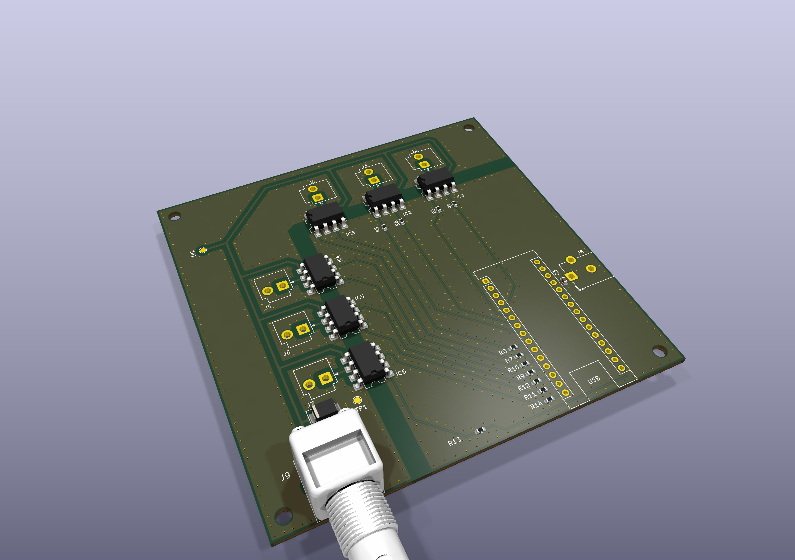
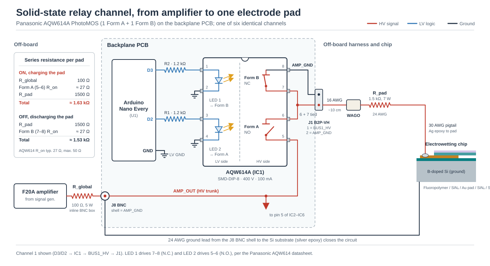
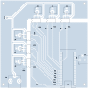

## The problem

In the condensation experiments, droplets are collected and moved by switching a high-voltage AC signal between rows of electrodes on the chip, first the collection rows and then the transport rows one after another. An electrode row is a group of electrodes joined to one contact pad, so they are always switched together.

The electronics therefore had to (1) connect one 120 Vpp, 250 Hz waveform from a single amplifier to any of six rows, (2) hold every row that is off at the potential of the grounded silicon substrate, (3) switch a row on or off well within a second without exceeding the current ratings of the amplifier or the relays, and (4) keep the low-voltage control side galvanically isolated from the high-voltage side.

Two of these requirements set most of the design. Electrically, each row is a capacitor several times larger than the load the amplifier is specified for, and an uncharged row draws a current surge the moment it is connected. Rows that are off also cannot simply be disconnected. A disconnected row keeps its charge and is charged further by leakage through the open relay, so it can still exert an electrowetting force on droplets that the next row is meant to pull away.

## My contribution

I designed the circuit, chose the PhotoMOS relays, laid out the two-layer board in KiCad and sized the series resistors that limit the switching current. The bare board was fabricated by JLCPCB. I hand-soldered all of its components, built the wiring harness that is bonded to the chip with silver epoxy, and wrote the Arduino firmware (C++) and the Python GUI.

## The board

The board takes the amplifier signal at one BNC input and splits it to six relays, one per electrode row.

*KiCad 3D render of the six-channel board. The BNC high-voltage input is at the lower left, the six PhotoMOS relays and their output headers run along the top and left edges, and the headers for the Arduino Nano Every are at the right.*

*One of the six identical channels, from the amplifier to one electrode pad. The Form A contact connects the row to the amplifier when the channel is on, and the Form B contact ties it to ground when it is off, which also discharges the electrode.*

*Top copper layout. The copper-free gap (white) beneath the relays separates the high-voltage side, along the top and left edges, from the low-voltage logic side and the Arduino Nano Every at the lower right.*

## How it works

### Signal path and grounding of rows that are off

A function generator (Koolertron DDS) drives a fixed-gain (×20) linear amplifier (Pendulum F20A, ±150 V, 150 mA maximum continuous output). The amplifier output passes through a 100 Ω global series resistor and a coaxial cable to the BNC input on the board, where it splits into six identical relay channels. Each channel uses one Panasonic AQW614A PhotoMOS relay, which contains a normally open (Form A) and a normally closed (Form B) switch.

Switching a channel on closes Form A and opens Form B, which applies the 120 Vpp waveform to the electrode row. Switching it off opens Form A and closes Form B, which connects the row to the boron-doped silicon substrate, the ground reference of the chip. The row then discharges through its series resistor and the relay with a time constant of about 5 to 9 µs, i.e., within about 50 µs. Once the row is grounded, leakage through the open relay can raise it by only ~1.5 mV, so a row that is off carries effectively no voltage.

### Series resistors

Each electrode row is a metal film separated from the grounded substrate by the 100 nm LPCVD silicon nitride layer, so electrically it is a parallel-plate capacitor of about 0.66 nF per mm² of metal. Rows of 5 to 9 mm² therefore have 3.3 to 6.0 nF, which is 8 to 15 times the ~400 pF capacitive load the amplifier is specified for. The manufacturer notes that larger capacitive loads cause overshoot.

The steady 250 Hz drive draws little current (~0.3 mA for a 3.3 nF row). The problem is the moment a channel switches on. If the row is connected near the peak of the waveform, the uncharged row briefly acts as a short circuit, and the current is limited only by the resistance in series with it.

For this reason, the signal path has two series resistors, a global resistor between the amplifier and the board (R_g = 100 Ω, 5 W) and a resistor on each channel's harness (R_pad = 1.5 kΩ, 7 W). Together with the relay on-resistance (27 Ω typical), the total series resistance is about 1.63 kΩ, which limits the peak surge current to

$$I_{\text{peak}} = \frac{V_0}{R_s} = \frac{60\text{ V}}{1.63\text{ k}\Omega} \approx 36.8\text{ mA}$$

This is below the 100 mA relay rating and the 150 mA amplifier limit. Without R_pad, the same event would draw ~0.47 A, above the relay's 0.3 A single-pulse rating.

In steady state, the resistors have little effect on the drive. At 250 Hz the reactance of the largest row is ~106 kΩ, so by this RC model the amplitude at the electrode pad is within ~0.012 % of the amplifier output, with a phase lag below 0.9°.

### Wiring to the chip

Each channel leaves the board through a two-pin JST VH header and a short 16 AWG jumper to a WAGO 221 lever terminal. From there, 24 AWG silicone-insulated wire carries the inline 1.5 kΩ resistor and ends in a 30 AWG pigtail.

The pigtail is bonded to the chip's contact pad with silver-filled conductive epoxy (MG Chemicals 8331S) and encapsulated in epoxy (MG Chemicals 832XFC) for insulation, moisture protection and strain relief. A separate lead, bonded to the silicon substrate with silver epoxy, connects the substrate to the shell of the board's BNC connector. The substrate, the coaxial shield and the board's high-voltage ground are therefore a single reference node.

### Firmware and GUI

The Arduino Nano Every drives the two LEDs inside each relay from its digital outputs, one LED per switch. The firmware (C++, PlatformIO) switches break-before-make. It opens one switch, waits a 200 ms dead time and only then closes the other, so a row is never connected to the amplifier and to ground at the same time. The dead time is well above the relays' 1 ms maximum switching time. When several channels change, the firmware switches them one at a time, which keeps their current surges from overlapping. With the LEDs unpowered, every row is grounded, including at power-up.

A Python GUI (Tkinter) sends commands to the Arduino over USB serial. It shows the state of each channel, switches channels individually or all off at once, and runs preset sequences, in which the firmware switches rows off before switching the next ones on.
