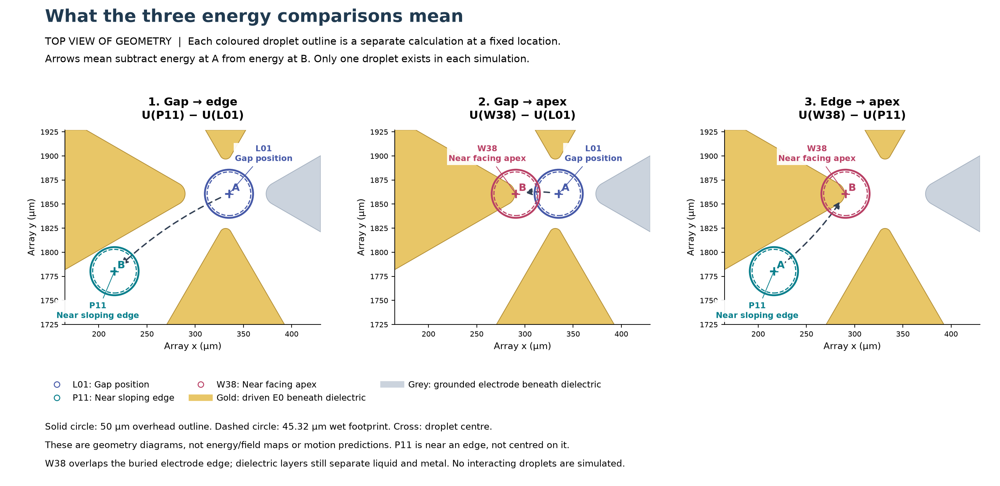
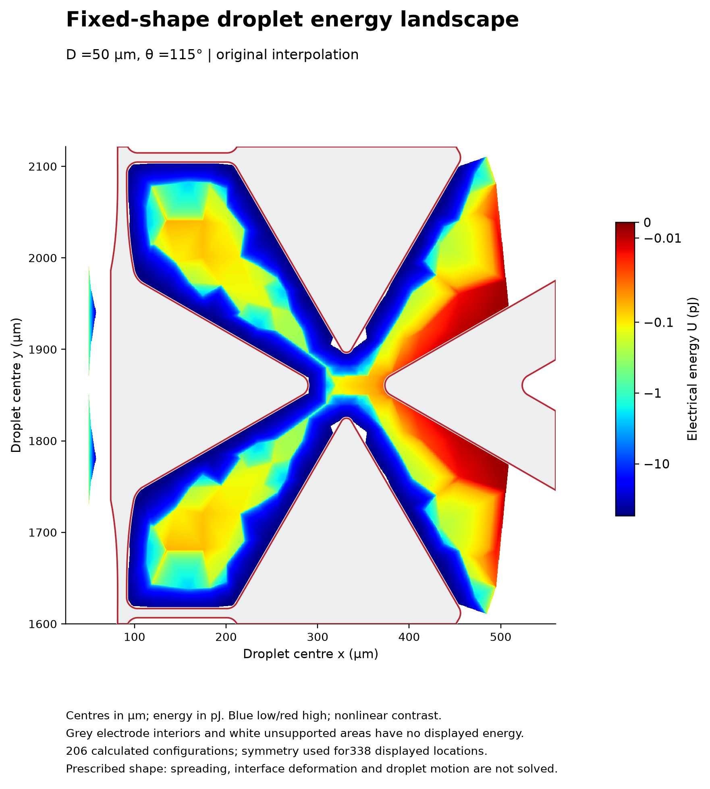
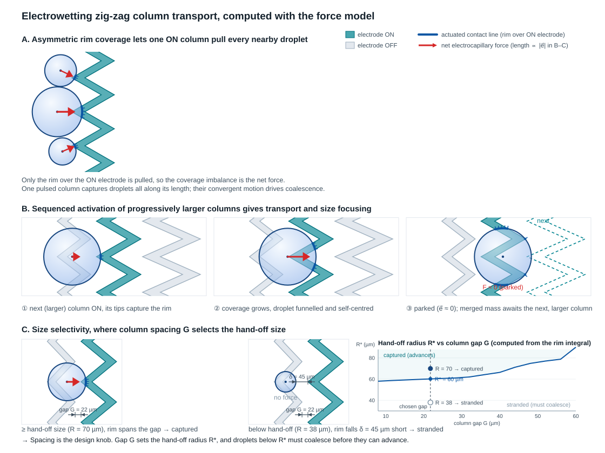

## The problem

Designing patterned electrodes for dropwise condensation involves two distinct challenges.

First, before fabricating photomasks in the cleanroom, designers must establish whether a proposed geometry will reliably pull a droplet toward an active electrode, sweep it into a collection zone, or leave it stranded in an inter-electrode gap. Fabricating multiple mask revisions is slow and expensive, requiring a fast predictive model to set electrode dimensions and spacing.

Second, once fabricated chips are operated under condensing conditions, explaining why droplets concentrate and settle at specific electrode features requires resolving the 3D spatial electrical-energy landscape across the multilayer dielectric stack. Lateral droplet motion and collection follow local energy gradients, which cannot be captured by 1D approximations alone.

## My contribution

I developed two complementary modelling frameworks to address both layout design and experimental rationalization.

To design the electrode layout before fabrication, I built a first-order 2D actuation force model in Python using NumPy and Shapely. By modelling droplets as circular footprints and integrating the electrocapillary force along the three-phase contact line, the model predicted net lateral actuation force as a function of droplet position, size and applied voltage. This established the chevron column dimensions and minimum hand-off radii.

To rationalize our experimental observations after fabrication, I built 3D finite-element electro-quasistatic models in COMSOL Multiphysics 6.3. I resolved the cycle-averaged electrical energy across 206 droplet positions over the collection and transport unit cell. When local re-meshing around moving droplets introduced numerical noise that obscured physical energy differences, I developed a matched-mesh water-minus-air subtraction method. This technique canceled background mesh discretization shifts down from roughly 1.94 pJ to 0.00000116 pJ (1.16 µpJ). I then benchmarked the numerical electrostatic energy against an analytical series-capacitance model treating the droplet as a floating conductor.

## Visual results and energy landscapes

*Geometry of the three tested droplet placements across the electrode array. Gold represents the driven electrode beneath the dielectric layers, while grey marks grounded metal. A single 50 µm spherical-cap droplet is evaluated at the inter-electrode gap (L01), near a sloping edge (P11), and over the facing apex (W38). Arrows indicate full-domain energy subtractions rather than trajectories.*

The 3D finite-element calculations revealed why droplets preferentially concentrate at electrode tips during experiments. Overlapping the driven electrode apex produces a substantially more negative stored electrical energy than the inter-electrode gap, creating a steep electrostatic potential well that draws condensate inward.

*Full-cell spatial electrical-energy landscape computed across 206 independent positions for a 50 µm droplet (45.32 µm wetted footprint). Darker blue regions indicate more negative relative stored energy (greater capacitive coupling and stronger attraction), mapped with a symmetric logarithmic scale. Gray masks the buried electrode interior.*

*First-stage 2D electrocapillary force model for chevron transport columns. (A) Asymmetric rim coverage pulls droplets overlapping an active column. (B) Progressively larger chevron columns gather droplets in sequence. (C) The inter-column gap defines a strict hand-off threshold, ensuring only sufficiently grown droplets are swept forward.*

The first-order 2D sweeps provided the essential design criteria for the physical photomask layout. The inter-column gap establishes a minimum hand-off radius. Droplets below this threshold remain pinned until local coalescence enlarges them, preventing premature detachment before reaching shedding scale.

## How it works and numerical methods

### 3D electro-quasistatic energy formulation

To evaluate how electrical energy varies with droplet position, the 3D computational domain in COMSOL Multiphysics 6.3 incorporates the patterned working electrodes, multilayer dielectric stack, grounded substrate, a water droplet of fixed spherical-cap geometry, and surrounding air.

Under an applied 120 Vpp, 250 Hz sinusoidal excitation (60 V peak amplitude), magnetic induction is negligible. The electric potential field satisfies the generalized Laplace form of Gauss's law for conducting media. Water was assigned a relative permittivity of 78.4 and an electrical conductivity of 0.0001 S/m, representative of air-exposed deionized water. The cycle-averaged stored electrical energy was integrated across the complete computational volume.

### Matched-mesh water-minus-air subtraction method

Evaluating droplet preference between alternative positions requires comparing full-domain stored energy. However, translating the droplet geometry alters local mesh topology, introducing discretization noise that can mask weak physical gradients.

To isolate the true relative electrical energy of the droplet, I implemented a paired subtraction reference calculation:

1. Compute full-domain electrical energy with the water droplet at position A, denoted W_water(A).
2. Assign air electrical properties to the exact same droplet domain without altering any mesh elements, and resolve the electric field to obtain W_air(A).
3. Define the relative electrical energy contribution as -[W_water(A) - W_air(A)].

Because water and air share the exact identical mesh at each position, background discretization shifts cancel out. In paired tests on the physical device geometry, a 1.94 pJ mesh-induced shift between alternative meshes produced only a 0.00000116 pJ discrepancy in the subtracted energy contrast.

### Analytical benchmarking

To validate the finite-element model, I benchmarked the numerical electrostatic energy against an analytical series-capacitance model. In this formulation, the conductive droplet acts as a floating conductor coupling the energized and reference electrodes through two capacitive pathways in series.

The equivalent dielectric thickness of each pathway accounts for the multilayer stack, which includes 100 nm LPCVD silicon nitride and 150 nm PECVD silicon nitride. The computed numerical energy differences agreed closely with the analytical capacitance scaling, confirming that the simulated potential wells reflect true electrocapillary attraction rather than numerical artifacts.
