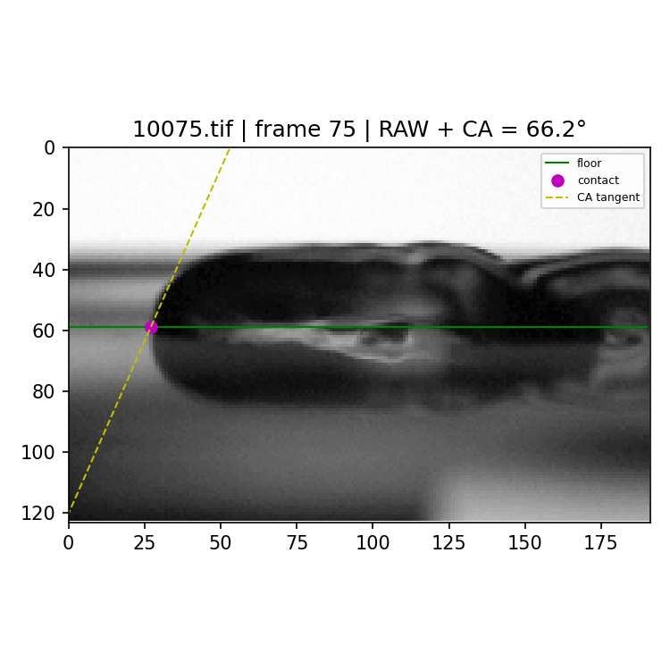
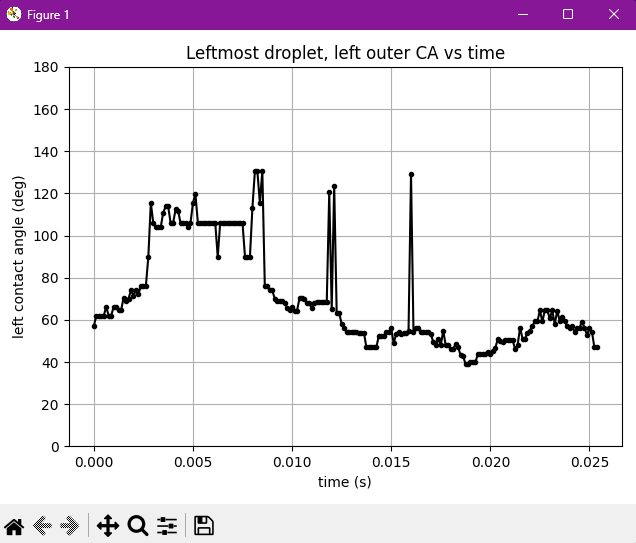

## The problem

When a liquid droplet rests on a solid surface, the angle between the liquid-vapor interface and the substrate is its contact angle, which defines how well the liquid wets the material.

On a vibrating surface, the droplet deforms and oscillates rapidly, causing its contact angle to fluctuate hundreds of times per second. Measuring these shape changes manually across thousands of frames is impossible. At the same time, standard commercial contact-angle instruments assume static or slowly evolving droplets, failing when optical reflections, moving contact lines, and severe interfacial deformations appear at 8,000 frames per second.

## My contribution

During a two-month research internship at the Institut de Physique de Nice (INPHYNI), I built an automated Python and OpenCV image-processing tool to track and measure dynamic contact angles frame by frame.

To ensure researchers could inspect and trust each measurement, I developed an interactive verification interface in Matplotlib. Clicking any data point on the contact-angle time trace instantly loads the corresponding raw video frame with the detected substrate floor, contact point, and fitted local tangent overlay. This allowed immediate visual verification of edge detection and rapid inspection of outliers.

During the visit, I also delivered an invited research seminar at INPHYNI on my electrowetting condensation research.

## Visual results and diagnostic tracking

<video controls playsinline preload="metadata" poster="/media/inphyni-contact-angle/vibrating-droplets-poster.png" aria-label="High-speed recording of a vibrating droplet, played in slow motion">
  <source src="/media/inphyni-contact-angle/vibrating-droplets.mp4" type="video/mp4" />
  <a href="/media/inphyni-contact-angle/vibrating-droplets.mp4">Download the droplet video</a>.
</video>

*The original droplet sequence showing 204 consecutive frames recorded at 8,000 frames per second and played back at 20 frames per second (400 times slower). The clip spans about 25.5 ms of physical vibration, showing the rapid interfacial oscillations that require frame-by-frame measurement.*

*A saved diagnostic frame from the Python analysis. The overlay marks the detected substrate baseline, the contact point, and the local boundary tangent. The numerical readout shows the calculated geometric contact angle for this individual frame.*

*Diagnostic contact-angle trace across consecutive frames from the method documentation. Because high-frequency excursions can reflect local surface noise or lighting artifacts, the curve serves as a navigational tool to inspect the underlying raw frames rather than an unverified final benchmark.*

## How it works and inspection workflow

### Pre-processing and region selection

Video sequences are first cropped and organized in Fiji (ImageJ). One image stack is binarized with thresholding operations to yield clear droplet outlines, while the raw grayscale stack is preserved alongside it for visual verification.

At the start of a run, the user defines a single bounding box on the initial frame. This region of interest encompasses the oscillating droplet, the solid substrate baseline, and the optical reflection below the floor, focusing computation on the active wetting boundary across the entire sequence.

### Floor and contact-point identification

In each frame, the algorithm scans the region of interest to locate the substrate baseline. Once the horizontal floor line is determined, the script traces the droplet boundary to detect where the liquid outline first intersects the solid substrate on the contact side.

### Tangent fitting and geometric angle calculation

Near the detected contact point, the local slope of the liquid-gas interface is evaluated using adjacent boundary pixels. The algorithm converts this local vector orientation relative to the horizontal floor into a geometric contact angle, recording the angle and time stamp for every frame.

### Interactive verification interface

Automated edge-finding algorithms can occasionally catch a glare or follow a drop reflection. To prevent undetected measurement errors, the pipeline plots contact angle versus time in an interactive Matplotlib window. Selecting any recorded point immediately loads the raw image frame and overlays the detected baseline, contact point, and tangent vector. Researchers can verify questionable measurements in seconds, combining the speed of batch processing with human-in-the-loop oversight.