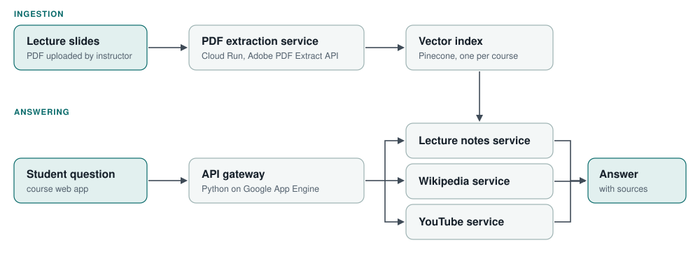

## The problem

Engineering students frequently struggle with foundational coursework in subjects like Fluid Dynamics and Thermodynamics. When seeking help outside lecture hours, general-purpose commercial chatbots often provide generic or contradictory textbook formulations that conflict with the specific notations, assumptions, and pedagogical methods used by the course instructor.

Instructors need automated question-answering tools that answer student inquiries using the instructor's own slide decks first. However, lecture slides present major extraction challenges because technical content is densely packed with mathematical equations, custom diagrams, and brief bullet points, mixed with decorative template borders and institutional logos that corrupt standard document parsers.

## My contribution

As co-developer, I engineered the backend cloud architecture and document ingestion pipeline for Prof Notes AI, an artificial-intelligence tutor system built for engineering education.

My contributions included:

- Designing the automated slide ingestion pipeline on Google Cloud Run, integrating the Adobe PDF Extract API to parse slide layouts, extract text and equations, and isolate technical figures.
- Implementing an automated filtering stage that discards decorative graphics, slide master templates, and institutional logos before embedding generation.
- Building the course-specific knowledge base by transforming structured slide content into vector embeddings stored in dedicated Pinecone indexes.
- Developing the central API gateway on Google App Engine, orchestrating parallel retrieval across course lecture slides, Wikipedia articles, and educational YouTube video transcripts.
- Co-authoring the peer-reviewed conference paper presented and published at the Canadian Engineering Education Association (CEEA 2025) annual conference.

## Visual architecture and tutor performance

*Prof Notes AI system architecture. Instructor slide decks are extracted and indexed into course-specific vector stores, while student inquiries are resolved through an API gateway coordinating lecture notes, Wikipedia, and YouTube services.*

The system was deployed across two core undergraduate engineering courses at York University, serving students in MECH 3202 (Fluid Dynamics) and MECH 2201 (Thermodynamics).

In practical classroom evaluations, the pipeline answered complex student queries in 6 to 9 seconds. By anchoring responses directly in the course's proprietary slide decks, the tutor provided immediate, contextually consistent guidance while citing the specific lecture slides that addressed each question.

## How it works and document pipeline

### Automated slide extraction and filtering

When an instructor uploads a course presentation, a containerized Cloud Run service submits the document to the Adobe PDF Extract API. The service parses each slide individually, extracting textual explanations, mathematical formulas, and embedded technical figures.

A custom filtering module analyzes each graphical element. Logos, headers, footers, and decorative slide borders are automatically stripped out, ensuring that only substantive technical diagrams and equations are retained. The remaining content is split into semantic chunks and indexed in a course-dedicated Pinecone vector database.

### Multi-source query answering

When a student submits a question through the course interface, the request hits the API gateway running on Google App Engine. The gateway coordinates three distinct retrieval services in parallel:

1. **Course lecture notes service:** Searches the Pinecone index to retrieve the most relevant slide segments, ensuring the primary response adopts the professor's notation and course scope.
2. **Wikipedia service:** Queries relevant encyclopedia entries to provide supplementary conceptual background for students needing foundational definitions.
3. **YouTube service:** Searches curated educational channels to identify specific video timestamps that demonstrate related physical principles.

### Prioritizing course material

To avoid overwhelming students or generating conflicting advice, the answering engine strictly prioritizes the instructor's slides. The system presents the course-grounded explanation as the authoritative answer, offering supplementary external resources only as optional secondary context for further study.