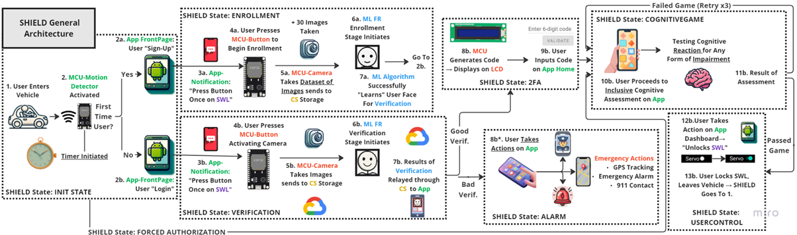
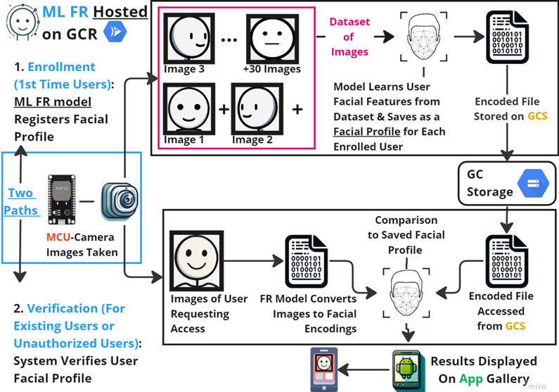
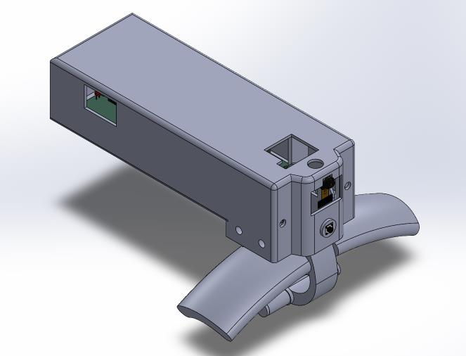

## Project

SHIELD (Security and Hazard Identification, Evaluation, Location and Deterrence) was our BEng capstone, an IoT system for in-vehicle monitoring that combines facial recognition, cloud computing and a mobile app.

*The team's system architecture, from the final capstone report. It shows how the recognition, vehicle-security and notification functions fit together.*

## My part

I co-led the seven-person team and designed and deployed the facial-recognition pipeline, packaged with Docker and running on Google Cloud Run.

*Enrollment and verification workflow from the team report, showing the recognition subsystem I developed and its cloud connections.*

## Team hardware

*The team's steering-wheel lock design connects the software workflow to the physical security system. This is team mechanical CAD; my contribution was co-leadership and the facial-recognition pipeline.*
